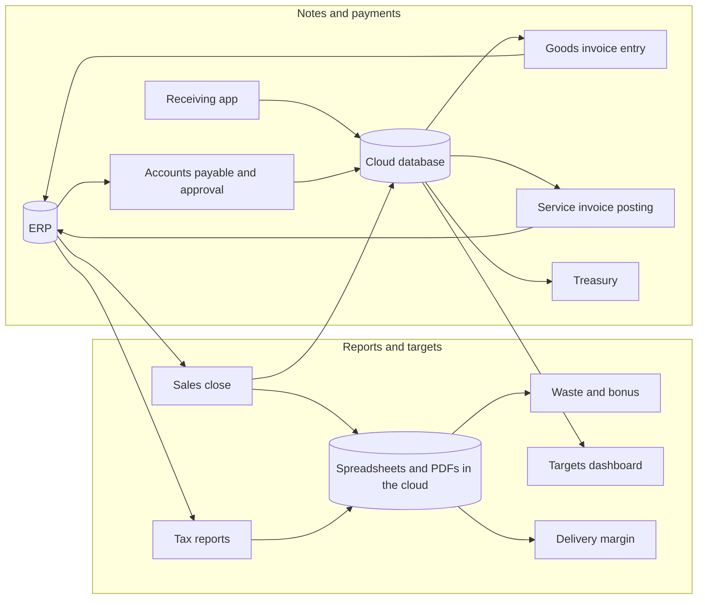

# Business automation portfolio

**Project and automation analyst.** I learn how a business area works, find the manual work and ship the complete solution, from the conversation with the team to a system running in production.

[Versão em português](README.md)

At a food-service retail chain I worked across several areas of the company and built an automation or system for each: finance, accounting, sales and targets, purchasing and inventory, operations and control. That is 9 projects with one common thread: **map the real process, turn the rules into code and always leave the final decision to a person.**

## What I automated, by area

| Area | Project | Status |
|---|---|---|
| Sales & targets | [Weekly sales close and targets](cases/01-fechamento-de-vendas-e-metas.md) | In production |
| Accounting & tax | [Monthly tax reports for accounting](cases/02-relatorios-fiscais-mensais.md) | In production |
| Finance | [Accounts payable: from extraction to approval and payment batch](cases/03-contas-a-pagar-aprovacao-e-bordero.md) | In production |
| Purchasing & inventory | [Goods-receipt invoices with AI assistance](cases/04-entrada-de-nfe-com-ia.md) | In use |
| Finance | [Assisted posting of service invoices](cases/05-lancamento-assistido-de-nfse.md) | In use |
| Finance & store operations | [Receiving and finance app (PWA)](cases/06-app-de-recebimento-e-financeiro.md) | In production |
| Operations & control | [Waste tracking and team bonus](cases/07-apuracao-de-descarte-e-bonus.md) | In production |
| Sales & delivery | [Delivery margin per app](cases/08-margem-de-delivery-por-app.md) | Evolving |
| Operations & control | [Ordering and production app](cases/09-app-de-pedido-e-producao.md) | In development |

Under study, no code yet: payment write-off routine, cash flow and income statement integrated with the treasury module.

## How the projects connect

## What these projects show

- **Business understanding:** process discovery and turning rules into code, with an honest status of what is in production, in testing and under study
- **Automation without APIs:** integrating with systems that have no API using Playwright, with failure handling, logging and notifications
- **Data and reporting:** Python, pandas, Excel and PDF
- **Databases and security:** PostgreSQL, SQL, triggers and role-based access (row level security)
- **Web apps:** installable PWA in plain JavaScript, with authentication, roles and offline support
- **Responsible applied AI:** OCR and unit conversion with Claude, always with human review before anything is saved

## How they were built

I built these projects myself, with Claude (Anthropic's AI assistant) as a programming partner: I define the problem and the rules, validate against the real process and decide what goes to production.

## Privacy and security

The repositories and documents in this portfolio do not contain:

- source code of the original implementations;
- credentials, passwords, keys or tokens;
- customer, employee or personal data;
- tax IDs, store or supplier names;
- internal URLs and paths;
- company files, spreadsheets or figures.

The original code stays private because it contains integrations and information from the corporate environment. The projects are presented as technical portfolio case studies.
