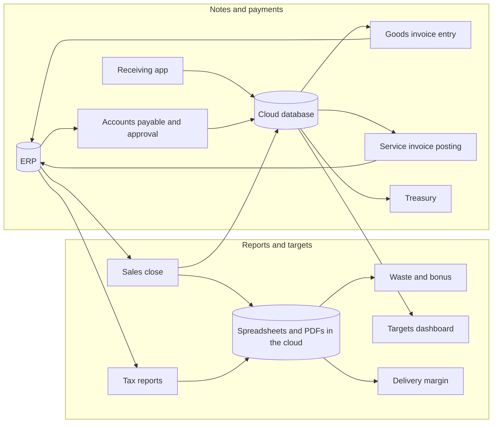

# Automações corporativas

**Analista de projetos e automação.** Entendo como uma área da empresa funciona, encontro o trabalho manual e entrego a solução completa, da conversa com o time até o sistema rodando em produção.

[English version](README.en.md)

Em uma rede de lojas do setor de alimentação, passei por várias áreas da empresa e criei uma automação ou um sistema para cada uma: financeiro, contabilidade, comercial e metas, compras e estoque, operação e controle. São 9 projetos, e o fio condutor é o mesmo: **mapear o processo real, transformar as regras em código e deixar uma pessoa sempre com a decisão final.**

## O que automatizei, por área

| Área | Projeto | Status |
|---|---|---|
| Comercial e metas | [Fechamento semanal de vendas e metas](casos/01-fechamento-de-vendas-e-metas.md) | Em produção |
| Contabilidade e fiscal | [Relatórios fiscais mensais para a contabilidade](casos/02-relatorios-fiscais-mensais.md) | Em produção |
| Financeiro | [Contas a pagar: da extração à aprovação e ao borderô](casos/03-contas-a-pagar-aprovacao-e-bordero.md) | Em produção |
| Compras e estoque | [Entrada de NF-e de mercadoria com apoio de IA](casos/04-entrada-de-nfe-com-ia.md) | Em uso |
| Financeiro | [Lançamento assistido de notas de serviço (NFS-e)](casos/05-lancamento-assistido-de-nfse.md) | Em uso |
| Financeiro e operação das lojas | [App de recebimento e financeiro (PWA)](casos/06-app-de-recebimento-e-financeiro.md) | Em produção |
| Operação e controle | [Apuração de descarte e bônus de equipe](casos/07-apuracao-de-descarte-e-bonus.md) | Em produção |
| Comercial e delivery | [Margem de delivery por aplicativo](casos/08-margem-de-delivery-por-app.md) | Em evolução |
| Operação e controle | [App de pedido e produção](casos/09-app-de-pedido-e-producao.md) | Em desenvolvimento |

Em estudo, ainda sem código: rotina de baixa de pagamentos, fluxo de caixa e DRE integrados ao módulo de tesouraria.

## Como os projetos se conectam

## O que esses projetos mostram

- **Visão de negócio:** levantamento de processos e tradução de regras em código, com status honesto do que está em produção, em teste e em estudo
- **Automação sem API:** integração com sistemas que não têm API, usando Playwright, com tratamento de falhas, logs e notificações
- **Dados e relatórios:** Python, pandas, Excel e PDF
- **Banco de dados e segurança:** PostgreSQL, SQL, triggers e controle de acesso por perfil (row level security)
- **Aplicativos web:** PWA instalável em JavaScript puro, com autenticação, perfis e funcionamento offline
- **IA aplicada com responsabilidade:** OCR e conversão de unidades com Claude, sempre com revisão humana antes de gravar

## Como eu trabalho

1. **Descubro o processo e o gargalo** conversando com quem opera a área.
2. **Inspeciono o sistema.** Quando não há API, analiso as telas (botões, formulários, URLs e o caminho de cada relatório) até entender como automatizar.
3. **Pesquiso e escolho a tecnologia** e o caminho de execução.
4. **Conduzo a IA com instruções precisas.** Eu defino o problema e as regras; o Claude (Anthropic) é meu parceiro de programação e eu reviso o que ele escreve.
5. **Testo com dados reais**, trato as falhas e só então deixo rodar sozinho.
6. **Mantenho uma pessoa com a decisão final** onde há risco.

## Privacidade e segurança

Os repositórios e documentos deste portfólio não contêm:

- código-fonte das implementações originais;
- credenciais, senhas, chaves ou tokens;
- dados de clientes, funcionários ou pessoais;
- CNPJs, nomes de lojas ou fornecedores;
- URLs e caminhos internos;
- arquivos, planilhas ou números da empresa.

O código original permanece privado por conter integrações e informações do ambiente corporativo. Os projetos são apresentados como *cases* técnicos de portfólio.
